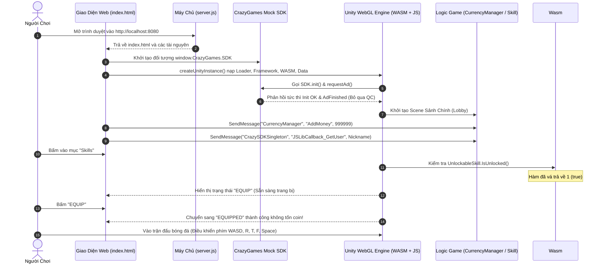

# SỔ TAY TOÀN TẬP VỀ HỆ THỐNG TẬP TIN & VẬN HÀNH GAME UNMATCHED EGO 2
> **Phiên bản:** Mod & Local Edition (Unity 6 WebGL / IL2CPP)  
> **Tài liệu tham chiếu:** `AGENTS.md`, `ARCHITECTURE.md`, `dump_gameplay_variables.cs`, `server.js`, `index.html`  
> **Ngôn ngữ:** Tiếng Việt (Vietnamese)  
> **Thời gian cập nhật:** Tháng 11/2026

---

## MỤC LỤC
1. [Giới Thiệu Tổng Quan Dự Án](#1-giới-thiệu-tổng-quan-dự-án)
2. [Sơ Đồ Cấu Trúc Thư Mục Toàn Dự Án](#2-sơ-đồ-cấu-trúc-thư-mục-toàn-dự-án)
3. [Chi Tiết Phân Hệ Sản Phẩm WebGL (`unmatched__ego/`)](#3-chi-tiết-phân-hệ-sản-phẩm-webgl-unmatched__ego)
4. [Chi Tiết Phân Hệ Dịch Ngược & Công Cụ Mod (`scratch/`)](#4-chi-tiết-phân-hệ-dịch-ngược--công-cụ-mod-scratch)
5. [Chi Tiết Phân Hệ Mã Nguồn & Tài Nguyên Unity](#5-chi-tiết-phân-hệ-mã-nguồn--tài-nguyên-unity)
6. [Chi Tiết Các Tệp Tin Công Cụ Ở Thư Mục Gốc (`E:\REG\`)](#6-chi-tiết-các-tệp-tin-công-cụ-ở-thư-mục-gốc-ereg)
7. [Ma Trận Liên Kết & Luồng Dữ Liệu Toàn Hệ Thống](#7-ma-trận-liên-kết--luồng-dữ-liệu-toàn-hệ-thống)
8. [Hướng Dẫn Thao Tác Dành Cho Người Dùng & Game Thủ](#8-hướng-dẫn-thao-tác-dành-cho-người-dùng--game-thủ)
9. [Hướng Dẫn Kỹ Thuật Dành Cho Developer & AI Agent](#9-hướng-dẫn-kỹ-thuật-dành-cho-developer--ai-agent)
10. [Nguyên Tắc Bất Di Bất Dịch Khi Chỉnh Sửa Game (Rule Checklist)](#10-nguyên-tắc-bất-di-bất-dịch-khi-chỉnh-sửa-game-rule-checklist)

---

## 1. Giới Thiệu Tổng Quan Dự Án

### 1.1. Bối cảnh & Mục đích
*Unmatched Ego 2* là tựa game thể thao bóng đá hành động 3v3 trên nền WebGL được phát triển bằng **Unity 6**, biên dịch qua công nghệ **IL2CPP** sang mã nhị phân **WebAssembly (WASM)**.

Dự án này là phiên bản **Mod & Local/Self-hosted Edition** với các mục tiêu kỹ thuật chính:
1. **Gỡ bỏ Sitelock & Quảng cáo:** Loại bỏ hoàn toàn sự phụ thuộc vào máy chủ cổng game gốc (CrazyGames), ngăn chặn tình trạng treo/đứng màn hình do không tải được SDK hay quảng cáo bên thứ ba.
2. **Mở khóa Kỹ Năng Miễn Phí (Skill Free Mod):** Can thiệp mã máy nhị phân WebAssembly để mở khóa 100% kỹ năng (Skills/Ultimates) cho nhân vật ngay từ đầu, cho phép người chơi bấm "Equip" tự do mà không bị cản trở bởi giá tiền hay cày cuốc.
3. **Tiện ích Hỗ trợ Người chơi (Mod Menu Toolbar):** Cung cấp giao diện nổi trực quan để đổi Tên nhân vật (Nickname) tự do, nạp Coin tức thì, và hiển thị phím bấm điều khiển kỹ năng trong trận đấu.
4. **Máy chủ Độc lập Cục bộ & Đám mây (Standalone Server):** Cung cấp server Node.js siêu nhẹ, hỗ trợ chơi Offline trên mạng nội bộ LAN (`localhost:8080`) hoặc triển khai 1-click lên nền tảng đám mây miễn phí như **Render.com** hoặc **Vercel**.

---

## 2. Sơ Đồ Cấu Trúc Thư Mục Toàn Dự Án

```
E:\REG
├── ARCHITECTURE.md                  # Tài liệu kiến trúc hệ thống cấp cao (High-level Architecture)
├── CHITIET_FILE_GAME.md             # (File này) Sổ tay chi tiết từng file, chức năng, mục đích và thao tác
├── dump_gameplay_variables.cs       # Bản dump 167.000 dòng mã C# chứa toàn bộ Class, Fields, Params từ metadata
├── extract_assets.py                # Tool Python xuất tài nguyên 3D, Sprite, Sound từ Unity Bundle qua UnityPy
├── index.html, *.gif                # Tệp gốc ghi nhận từ quá trình clone web (HTTrack Copier)
│
├── unmatched__ego/                  # [PHÂN HỆ SẢN PHẨM] Mã nguồn và dữ liệu chạy game WebGL
│   ├── Build/                       # Bộ tệp WebGL Engine chính (Loader, Framework, WASM, Data)
│   │   ├── unmatched-ego-2.loader.js       # Bộ nạp runtime WebGL của Unity
│   │   ├── unmatched-ego-2.framework.js    # Cầu nối Emscripten JS & bản vá Sitelock/CrazyGames
│   │   ├── unmatched-ego-2.wasm            # Nhân C++ IL2CPP đã vá nhị phân mở khóa toàn bộ Skill
│   │   └── unmatched-ego-2.data            # Gói tài nguyên đóng gói (3D Model, Texture, Âm thanh)
│   ├── index.html                   # Giao diện chính, Mock SDK CrazyGames, Mod Menu, Anti-cache
│   ├── server.js                    # Web server Node.js HTTP phục vụ tệp tĩnh & API database.json
│   ├── start_game.bat               # Script Windows 1-click khởi động server và mở trình duyệt
│   ├── database.json                # Cơ sở dữ liệu JSON lưu trữ thông số người chơi, cấu hình
│   ├── package.json                 # Cấu hình dự án Node.js
│   ├── render.yaml                  # Cấu hình Blueprint tự động deploy lên Render.com
│   ├── vercel.json                  # Cấu hình định tuyến và caching headers cho Vercel
│   ├── README.md                    # Hướng dẫn chơi nhanh cho người dùng phổ thông
│   ├── AGENTS.md                    # Nguyên tắc sống còn khi chỉnh sửa dành cho AI Agent
│   └── ARCHITECTURE.md              # Bản sao kiến trúc hệ thống
│
├── scratch/                         # [PHÂN HỆ NGHIÊN CỨU & DỊCH NGƯỢC]
│   ├── global-metadata.dat          # Metadata gốc IL2CPP chứa toàn bộ Type, String, Method definitions
│   ├── Il2CppDumper/                # Bộ công cụ Il2CppDumper trích xuất header C# & script Ghidra/IDA
│   ├── apply_wasm_skill_patch.py    # Script vá thử nghiệm hàm mở khóa Skill
│   ├── patch_all_skills.py          # Script vá toàn diện 6 điểm trong file WASM (Zero-offset drift)
│   ├── patch_framework.py           # Script vá Emscripten runtime và giả lập SDK
│   ├── patch_framework_user.py      # Script tinh chỉnh giao diện nhập Nickname và bàn phím ảo
│   ├── trace_*.py, disasm_*.py      # Tập hợp các công cụ Disassembler nhị phân WASM tự viết
│   ├── find_*.py, inspect_*.py      # Các script tra cứu offset, table index, token và method metadata
│   ├── test_user_flow.js, test_*.js # Kịch bản kiểm thử tự động headless Chrome qua DevTools Protocol
│   └── *.png                        # Ảnh chụp màn hình kiểm thử tự động giao diện và tính năng game
│
├── UnmatchedEgo_UnityProject/       # [DỰ ÁN TÁI LẬP UNITY] Cấu trúc dự án xuất bởi AssetRipper
│   └── Assets/
│       ├── Scripts/Assembly-CSharp/ # Mã nguồn C# giao diện các component logic game
│       ├── AnimationClip/           # Các clip hoạt ảnh nhân vật và bóng
│       ├── AudioClip/               # Hiệu ứng âm thanh trận đấu, tiếng khán giả, tiếng còi
│       ├── Material/, Mesh/         # Vật liệu và mô hình sân cỏ, lưới, cầu thủ
│       └── Resources/               # Cấu hình NavMesh Agent và tài nguyên nạp động
│
└── extracted_assets/                # [TÀI NGUYÊN ĐÃ XUẤT RỜI RẠC]
    ├── Texture2D/, Sprite/          # Toàn bộ ảnh texture nhân vật, biểu tượng kỹ năng (PNG)
    ├── Mesh/                        # Mô hình 3D định dạng Wavefront (.obj)
    ├── AudioClip/                   # File âm thanh định dạng sóng (.wav)
    ├── AnimationClip/               # Dữ liệu hoạt ảnh xuất dạng JSON
    └── TextAsset/                   # Các file kịch bản văn bản cấu hình (.txt)
```

---

## 3. Chi Tiết Phân Hệ Sản Phẩm WebGL (`unmatched__ego/`)

Thư mục này đại diện cho bản dựng phát hành chính thức, sẵn sàng đưa lên hosting hoặc chạy ngay trên máy cá nhân.

```mermaid
flowchart TD
    ClientBrowser[Trình duyệt Người chơi] -->|Mở URL http://localhost:8080| ServerJS[server.js - Node.js HTTP Server]
    ServerJS -->|Phục vụ| IndexHTML[index.html]
    ServerJS -->|Phục vụ tĩnh /Build| BuildFolder[Build/]
    ServerJS -->|Đọc / Ghi API /api/database| DatabaseJSON[database.json]
    
    subgraph ClientRuntime [Môi Trường Runtime Client (Trình duyệt)]
        IndexHTML -->|1. Cung cấp| MockSDK[window.CrazyGames.SDK Mock]
        IndexHTML -->|2. Nạp script| LoaderJS[unmatched-ego-2.loader.js]
        IndexHTML -->|3. Hiển thị UI| ModToolbar[Mod Menu & Nickname Toolbar]
        LoaderJS -->|Tải & Khởi tạo| FrameworkJS[unmatched-ego-2.framework.js]
        LoaderJS -->|Tải & Biên dịch| WasmFile[unmatched-ego-2.wasm]
        LoaderJS -->|Nạp dữ liệu 3D| DataFile[unmatched-ego-2.data]
        
        ModToolbar -->|SendMessage AddMoney| UnityInstance[Unity WebGL Instance]
        ModToolbar -->|SendMessage SetNickname| UnityInstance
        WasmFile -.->|Vá hàm IsUnlocked = 1| UnityInstance
    end
```

### 3.1. `unmatched__ego/index.html`
- **Mục đích:** Là trang wrapper trung tâm, đóng vai trò "cửa sổ hiển thị" và môi trường thực thi của game trên trình duyệt.
- **Chức năng chính:**
  1. **Hiển thị & Loading Overlay:** Cung cấp màn hình chờ hiện đại với thanh tiến trình gradient và thông báo trạng thái tải tài nguyên 3D (từ 0% đến 100%).
  2. **Giả lập CrazyGames SDK (`window.CrazyGames.SDK`):** Cung cấp các hàm giả lập: `init()`, `requestAd()`, `happytime()`, `gameplayStart()`, `gameplayStop()`, `user.getUser()`. Nhờ đó, game tin rằng đang chạy trong cổng CrazyGames thật và không dừng tiến trình chờ quảng cáo.
  3. **Cơ chế Chống Lưu Đệm Trình Duyệt (Anti-Cache Busting):**
     - Khai báo tham số `BUILD_VER = "v5"`, tự động nối `?v5` vào các file `dataUrl`, `frameworkUrl`, `codeUrl`.
     - Cấu hình thuộc tính `cacheControl: () => "no-store"` ngăn UnityCache lưu phiên bản cũ vào IndexedDB.
     - Đoạn mã khởi đầu tự động quét và gọi `indexedDB.deleteDatabase("UnityCache")` để xóa bỏ dữ liệu lưu đệm lỗi thời trên máy người chơi.
  4. **Bảng điều khiển Mod Menu (`#mod-toolbar`):**
     - Nút gạt mở/đóng menu mod tiện lợi góc trên bên phải.
     - Tính năng **Đổi Nickname người chơi:** Ô nhập văn bản cho phép đặt tên bất kỳ (lưu trữ vào `localStorage` key `unmatched_player_name`), tự động truyền vào C# qua hàm `CrazySDKSingleton.JSLibCallback_GetUser`.
     - Tự động đồng bộ Nickname sau 3.5 giây kể từ khi game khởi động thành công vào sảnh chính.
     - Ghi chú: Mở khóa 100% Kỹ năng và Gỡ bỏ hoàn toàn rào cản tiền tệ lõi (không còn phụ thuộc nút nạp coin).
     - Bảng hướng dẫn phím tắt sử dụng kỹ năng trong trận đấu.
  5. **Auto Focus Canvas:** Lắng nghe sự kiện click/mousedown vào thẻ `#unity-canvas` để tự động gán nét (`canvas.focus()`), đảm bảo bàn phím luôn nhận lệnh điều khiển trận đấu mượt mà.
- **Liên kết:** Nạp trực tiếp `Build/unmatched-ego-2.loader.js`, gọi hàm `createUnityInstance`, giao tiếp 2 chiều với Unity engine qua `window.unityInstance`.

---

### 3.2. `unmatched__ego/server.js`
- **Mục đích:** Máy chủ web siêu nhẹ độc lập, không phụ thuộc vào thư viện ngoài (zero external dependencies), chỉ dùng module `http`, `fs`, `path` có sẵn của Node.js.
- **Chức năng chính:**
  1. **Phục vụ tệp tĩnh (Static Asset Serving):** Nhận dạng và gắn đúng MIME Type cho các định dạng: `.html`, `.js`, `.wasm`, `.data`, `.json`, `.css`, `.png`, v.v.
  2. **Tối ưu hóa Cache Header:**
     - Thiết lập `Cache-Control: public, max-age=31536000, immutable` cho các tệp tĩnh nặng trong thư mục `/Build/` giúp trình duyệt tải lại ngay lập tức trong các lần chơi sau.
     - Thiết lập `Cache-Control: no-cache` cho `index.html` và file cấu hình để luôn nhận được cập nhật mới nhất.
  3. **Xử lý luồng dữ liệu an toàn (Stream Safety):** Sử dụng `fs.createReadStream` kết hợp bắt sự kiện `readStream.on('error')` và `res.on('close')`. Điều này ngăn chặn triệt để tình trạng crash tiến trình Node.js khi người chơi vô tình đóng tab trong lúc máy đang truyền file tài nguyên dung lượng lớn (56MB).
  4. **Cung cấp API Cơ sở dữ liệu:**
     - `GET /api/database`: Trả về dữ liệu JSON lưu trong `database.json`.
     - `POST /api/save`: Tiếp nhận dữ liệu lưu từ client để ghi nhận tiến trình.
  5. **Health Check Endpoint:** Phục vụ `/healthz` và `/api/health` trả về JSON `{ status: 'ok', uptime: ... }` phục vụ kiểm tra trạng thái hoạt động (uptime monitoring) trên các nền tảng đám mây như Render.com.
- **Liên kết:** Đọc và ghi `database.json`, phân phối tệp trong thư mục gốc và thư mục con `Build/`.

---

### 3.3. `unmatched__ego/Build/unmatched-ego-2.loader.js`
- **Mục đích:** Script nạp (Bootstrap Loader) tiêu chuẩn do Unity WebGL 6 xuất ra.
- **Chức năng:** Kiểm tra khả năng hỗ trợ WebAssembly, WebGL của trình duyệt; phân tích dung lượng, giải nén và điều phối quá trình tải đồng thời 3 tệp: `.framework.js`, `.wasm`, và `.data`.
- **Liên kết:** Được nạp bởi `index.html`, sau đó nạp tiếp `unmatched-ego-2.framework.js` và `unmatched-ego-2.wasm`.

---

### 3.4. `unmatched__ego/Build/unmatched-ego-2.framework.js`
- **Mục đích:** Cầu nối trung gian (Emscripten Javascript Bridge) kết nối giữa môi trường JavaScript của trình duyệt và môi trường thực thi WebAssembly C++.
- **Các điểm đã được can thiệp & vá (Patched):**
  1. **Vá hàm `_InitSDK`:** Tự động khởi tạo mock object `window.CrazyGames.SDK`, hỗ trợ đầy đủ các module con `ad`, `banner`, `data`, `game`, `user`, `analytics`. Tự động bắn thông điệp `SendMessage("CrazySDKSingleton", "JSLibCallback_Init")` và `JSLibCallback_AdblockDetectionResult` vào C# chỉ sau 50ms.
  2. **Vá hàm `_RequestAdSDK`:** Biến hàm yêu cầu quảng cáo thành cuộc gọi rỗng và lập tức phản hồi `SendMessage("CrazySDKSingleton", "JSLibCallback_AdFinished")`, loại bỏ hoàn toàn thời gian chờ quảng cáo.
  3. **Vá hàm `_RequestBannersSDK`:** Vô hiệu hóa việc gọi tải banner từ bên thứ ba.
  4. **Khắc phục lỗi dừng màn hình (Exception Handling):** Sửa lại hàm `handleException` để ghi cảnh báo `console.warn` thay vì gọi lệnh `quit_(1, e)` làm treo toàn bộ game khi gặp các lỗi JS không nghiêm trọng.
  5. **Vá bàn phím ảo (Mobile Keyboard Patch):** Bổ sung `z-index: 999999` cho container nhập liệu và gắn thêm sự kiện `click` cho nút OK (nguyên gốc chỉ hỗ trợ `touchend` trên di động).
- **Liên kết:** Giao tiếp trực tiếp với bộ nhớ tuyến tính của `unmatched-ego-2.wasm`.

---

### 3.5. `unmatched__ego/Build/unmatched-ego-2.wasm`
- **Mục đích:** "Trái tim" của toàn bộ trò chơi — chứa toàn bộ mã máy C++ (biên dịch từ toàn bộ mã C# của game thông qua Unity IL2CPP + Photon Quantum). Dung lượng chuẩn: `29,724,971 bytes`.
- **Bản vá nhị phân toàn diện (Verified v2 Patches via `scratch/apply_dynamic_awakening_v2.py`):**
  Toàn bộ các điểm can thiệp được tra cứu chính xác từ `CodeGenModule` và giữ nguyên 100% kích thước byte (**Zero-offset drift**, đạt `WebAssembly.validate() === true`):

| Nhóm Tính Năng | Hàm trong WASM | Byte Offset | Kích thước | Logic C# Gốc | Logic Sau Khi Vá |
| :--- | :--- | :---: | :---: | :--- | :--- |
| **Kỹ năng (Free Equip)** | **Func #19882** | `5399356` | 84 bytes | `.UnlockableSkill.IsUnlocked` | Trả về hằng số `1` (`true`) |
| **Kỹ năng (Free Equip)** | **Func #13574** | `3505570` | 78 bytes | `.UnlockableSkill.IsSkillUnlocked` | Trả về hằng số `1` (`true`) |
| **Tiền tệ (Free Equip)** | **Func #19927** | `5415551` | 44 bytes | `.CurrencyManager.SpendMoney` | Trả về hằng số `1` (`true`), không trừ Coin |
| **Tắt Gacha Sảnh** | **Func #71277** | `19177554` | 225 bytes | `.GachaSystem.StartRoll` | Thoát hàm rỗng (`void return`) |
| **Helper Roll Động** | **Func #71267** | `19175946` | 1018 bytes | `.<RollRoutine>d__39.MoveNext` | `RollDifferentAwakening`: gọi `RNGSession.Next` (`#15255`) chọn `1..14` luôn khác Awakening trước; ghi telemetry `0x550000..0x55000c` |
| **Helper Guard/Init** | **Func #35717** | `9840797` | 336 bytes | `.GachaSystem.PickRarity` | `GuardOrInitAwakening`: trả `-1` nếu `disableAwk != 0`; khởi tạo ngẫu nhiên khi ngoài `[1..14]` |
| **Helper HUD Sync** | **Func #73489** | `19565713` | 401 bytes | `CrazyGames.BannerModuleDemo.RequestVideo` | `SyncHudAwakening`: đọc `GachaSystem.Instance->awakenings` (`+0x18`) và cập nhật `GameManager->awkName` (`+0x400`) |
| **Hook Update** | **Func #85853** | `21446736` (`+294`) | 35 bytes | `Quantum.MovementSystem.Update` | Ngừng gán cứng `RuntimePlayer->awkIndex` (`+0x74`), gọi `GuardOrInitAwakening` (`#35717`) |
| **Hook Grant** | **Func #23569** | `6349177` | 1325 bytes | `GameplaySystem.GrantRandomAwakening` | Gọi `RollDifferentAwakening` (`#71267`) khi hệ thống chọn người nhận Awakening trong trận Thường & Private |
| **Hook Perform** | **Func #44328** | `12233811` | 795 bytes | `Quantum.MovementSystem.PerformAwk` | Sau khi dùng Awakening thành công (`currentSkill = old + 50`), gọi `RollDifferentAwakening` (`#71267`) đổi sang loại khác cho lần sau |
| **Hook HUD** | **Func #56046** | `17307981` (`+2199`) | 11 bytes | `PlayerView.OnUpdateView` | Gọi `SyncHudAwakening` (`#73489`) trong nhánh `PlayerIsLocal` |

- **Kết quả thực tế trong game:**
  - Kỹ năng miễn phí 100%, bấm "Equip" trang bị vào slot ngay không mất Coin (`500` giữ nguyên).
  - Vòng quay Gacha ở sảnh bị vô hiệu hóa (`RANDOM\nIN MATCH`), không tốn Coin.
  - Trong cả **Normal / Casual / Ranked / Bot Match** và **Private Match (thường & Infinite Abilities)**, game giữ nguyên hoàn toàn điều kiện và cơ chế chọn người nhận Awakening, nhưng mỗi lần khởi tạo, được trao hoặc kích hoạt (`F`), `Player->awkIndex` đều được random sang một loại khác trong `[1..14]` và hiển thị đúng tên trên HUD.

---

### 3.6. `unmatched__ego/Build/unmatched-ego-2.data`
- **Mục đích:** Kho lưu trữ tài nguyên nén đóng gói của Unity WebGL (dung lượng chuẩn: `56,265,176 bytes`).
- **Bản vá chuỗi giao diện người dùng (String Replacements Applied):**
  Các chuỗi văn bản giá tiền và mua sắm trong file data đã được thay thế trực tiếp, giữ nguyên 100% kích thước byte:
  - `Buy ({0})` (9b) $\rightarrow$ `Equip    ` (9b)
  - `Unlock {0} for {1} coins?` (25b) $\rightarrow$ `Equip {0}?               ` (25b)
  - `ROLL\n1000 COINS` (15b) $\rightarrow$ `RANDOM\nIN MATCH` (15b)
  - `Not enough coins!` (17b) $\rightarrow$ `RANDOM IN MATCH\0\0` (17b)

---

### 3.7. Các Tệp Cấu Hình & Triển Khai Trong `unmatched__ego/`
- **`start_game.bat`:** Tệp script thực thi theo lô trên Windows. Khi người dùng click đúp, file sẽ chuyển đường dẫn vào thư mục, mở trình duyệt mặc định vào `http://localhost:8080`, và chạy lệnh `node server.js`.
- **`database.json`:** Tệp cơ sở dữ liệu dạng JSON. Chứa các bản ghi mẫu về danh sách người chơi (`players`), cài đặt âm thanh/đồ họa (`gameSettings`), và lịch sử trận đấu (`matchHistory`).
- **`package.json`:** Khai báo thông tin dự án Node.js (`name: unmatched-ego-2`), lệnh chạy `npm start` (`node server.js`), và yêu cầu phiên bản Node.js $\ge 18.0.0$.
- **`render.yaml`:** Tệp cấu hình hạ tầng dạng mã (Infrastructure-as-Code) dành cho nền tảng Render.com. Định nghĩa một dịch vụ Web Service chạy môi trường `node`, gói `free`, chạy lệnh `node server.js`.
- **`vercel.json`:** Định nghĩa các quy tắc Header khi triển khai trên Vercel: thiết lập `Content-Type: application/wasm` cho `.wasm`, `application/octet-stream` cho `.data`, và kích hoạt tiêu đề `Access-Control-Allow-Origin: *`.
- **`README.md`:** Bản tóm tắt ngắn gọn dành cho người chơi thông thường để biết cách cài đặt Node.js và chạy game để chơi cùng bạn bè.
- **`AGENTS.md`:** Bản hướng dẫn quy tắc cốt lõi dành cho AI Agent khi thao tác trên repository này.

---

## 4. Chi Tiết Phân Hệ Dịch Ngược & Công Cụ Mod (`scratch/`)

Thư mục `scratch/` là **kho vũ khí kỹ thuật** chứa toàn bộ các công cụ phân tích nhị phân, giải mã opcode, tra cứu vtable và script tự động hóa. Theo quy định tại `AGENTS.md`, **tuyệt đối không được xóa các tệp trong thư mục này**.

### 4.1. Tệp Dữ Liệu Metadata & Bộ Công Cụ Dumper
- **`scratch/global-metadata.dat` (~9.85 MB):** Tệp metadata gốc được trích xuất từ bản build IL2CPP của game. Chứa toàn bộ bảng chuỗi ký tự (String Literals), định nghĩa kiểu dữ liệu (Type Definitions), chữ ký phương thức (Method Signatures), và bù địa chỉ thuộc tính (Field Offsets).
- **`scratch/Il2CppDumper/`:** Công cụ dịch ngược IL2CPP nổi tiếng:
  - `Il2CppDumper.exe` / `Il2CppDumper-x86.exe`: Ứng dụng thực thi chính đọc metadata và binary để bóc tách cấu trúc assembly.
  - `ghidra_wasm.py`: Script nhập cấu trúc kiểu và nhãn hàm vào công cụ dịch ngược Ghidra dành riêng cho file WebAssembly.
  - `ida.py`, `ida_py3.py`, `ida_with_struct.py`: Các script hỗ trợ phân tích trên phần mềm IDA Pro.
  - `config.json`: Cấu hình trích xuất của Il2CppDumper.

---

### 4.2. Nhóm Script Phân Tích Metadata & Cấu Trúc Lớp (Class & Method Discovery)
- **`scratch/generate_dump_cs.py`:** Đọc cấu trúc từ `global-metadata.dat` và trích xuất ra file tổng hợp `dump_gameplay_variables.cs` ở thư mục gốc.
- **`scratch/dump_gameplay_classes.py` & `dump_specific.py`:** Lọc riêng các lớp liên quan chặt chẽ đến cơ chế chơi bóng như `Player`, `Ball`, `Movement`, `CharacterCustomization`, `Skills`, `Currency`.
- **`scratch/find_skill_classes.py` & `inspect_skill_methods.py`:** Tìm kiếm định danh Token, chỉ mục vtable và tên các phương thức nằm trong lớp `UnlockableSkill`.
- **`scratch/find_coins.py`, `inspect_currency.py`, `find_calls_to_loadmoney.py`:** Phân tích logic quản lý tiền tệ trong game, tìm ra đối tượng `CurrencyManager` và 2 hàm quan trọng `AddMoney(int amount)` và `SpendMoney(int amount)`.
- **`scratch/filter_gameplay_skills.py` & `scan_all_skills.py`:** Tạo ra danh sách toàn bộ các kỹ năng có trong game (kết quả lưu tại `scratch/all_skills_found.txt`).
- **`scratch/find_resetcd.py`, `inspect_resetcd_body.py`:** Phân tích cơ chế hồi chiêu (Cooldown) của các tuyệt chiêu nhằm phục vụ khả năng mod hồi chiêu 0 giây.

---

### 4.3. Nhóm Script Disassembler & Phân Tích Nhị Phân WebAssembly (WASM Analysis)
- **`scratch/find_code_sec.py` & `find_elem_sec.py`:** Đọc cấu trúc phần đầu (Header) và định vị chính xác vị trí bắt đầu, kích thước của **Code Section (Section ID 10)** và **Element Section (Section ID 9)** trong file `.wasm`.
- **`scratch/find_t_for_funcs.py`:** Đọc bảng chỉ mục gián tiếp (Indirect Call Table) trong Element Section để ánh xạ giữa con trỏ hàm trong bảng vtable và chỉ số hàm (Function Index) thực tế.
- **`scratch/trace_unlock_equip.py`, `trace_43443.py`, `trace_23217.py`:** Bộ dịch ngược mã máy (Disassembler) tự viết bằng Python: đọc các byte chỉ lệnh của hàm mục tiêu, bóc tách các opcode WASM như `local.get` (`0x20`), `i32.const` (`0x41`), `call` (`0x10`), `call_indirect` (`0x11`), `br_if` (`0x0d`), `end` (`0x0b`).
- **`scratch/disasm_isunlocked.py` & `disasm_refreshbutton.py`:** Soi chi tiết từng byte lệnh của các hàm quyết định trạng thái hiển thị của nút kỹ năng trên giao diện UI.

---

### 4.4. Nhóm Script Vá Mã Nhị Phân (Binary Patching Tools)
- **`scratch/apply_phase3b_v2.py` (Script Tổng Hợp Vá Toàn Bộ Các Giai Đoạn):**
  - Tự động đọc bản gốc `unmatched-ego-2.wasm.bak` và `unmatched-ego-2.data.bak`.
  - Áp dụng đầy đủ 23 điểm vá WASM (Tiền tệ, Kỹ năng, Gacha, Random Awakening) và các chuỗi giao diện người dùng.
  - Tự động chạy xác thực `WebAssembly.validate()`.
- **`scratch/patch_all_skills.py`:** Script vá kỹ năng Phase 2 ban đầu.
- **`scratch/apply_phase3a.py` & `apply_phase3b.py`:** Các script nghiên cứu và phát triển theo từng giai đoạn.
- **`scratch/patch_framework.py`:** Đọc tệp `Build/unmatched-ego-2.framework.js`, tự động chèn mock SDK CrazyGames, xử lý tắt quảng cáo và gắn bẫy `handleException`.
- **`scratch/patch_framework_user.py`:** Vá `framework.js` để đẩy `z-index` của bàn phím ảo lên mức cao nhất (`999999`) và kích hoạt sự kiện click chuột cho nút OK.

---

### 4.5. Nhóm Kịch Bản Kiểm Thử Giao Diện & Trận Đấu Tự Động (Headless CDP & E2E)
- **`scratch/e2e_phase4a_test.js` (Kịch Bản Kiểm Thử E2E Toàn Diện):**
  - Khởi động server Node.js ngầm trên cổng tự do, kết nối Chrome Headless qua Chrome DevTools Protocol (CDP).
  - Tự động kiểm tra tuần tự: Nạp game $\rightarrow$ Kiểm tra bộ nhớ ban đầu $\rightarrow$ Bỏ qua popup $\rightarrow$ Kiểm tra Mod Menu UI $\rightarrow$ Mở & nhấp Gacha panel (`RANDOM IN MATCH`) $\rightarrow$ Mở & trang bị Kỹ năng trực tiếp $\rightarrow$ Ghép trận Casual Match $\rightarrow$ Chọn đội và spawn vào sân cỏ $\rightarrow$ Đo đọc chỉ số Awakening trong trận $\rightarrow$ Đổi ngẫu nhiên Awakening Trận 2.
  - Xuất báo cáo chi tiết ra file `scratch/e2e_phase4a_report.json`.
- **`scratch/verify_phase3b_gameplay.js` & `test_spawn_player.js`:** Các kịch bản kiểm tra spawn nhân vật và bốc tách biến bộ nhớ `0x550000`.
- **Các tệp ảnh chụp màn hình kiểm định E2E (`e2e_4a_*.png`):**
  - `e2e_4a_1_lobby.png`: Sảnh chờ game sau khi bỏ qua popup.
  - `e2e_4a_2_mod_menu.png`: Menu mod hiển thị đổi Nickname và Awakening đang dùng.
  - `e2e_4a_3_gacha_panel.png`: Bảng Gacha hiển thị nút `RANDOM\nIN MATCH`.
  - `e2e_4a_4_gacha_clicked.png`: Bấm thử nút Gacha xác nhận an toàn, không tốn coin.
  - `e2e_4a_5_skills_overview.png`: Màn hình toàn bộ kỹ năng miễn phí với nút `Equip`.
  - `e2e_4a_6_skills_equipped.png`: Trang bị trực tiếp thành công không hiện hộp thoại mua.
  - `e2e_4a_7_room_joined.png`: Màn hình phòng chờ kết nối.
  - `e2e_4a_8_gameplay_match1_4.png`: Cầu thủ spawn trên sân bóng thi đấu cùng Awakening #0 (Playmaker).
  - `e2e_4a_9_gameplay_match2.png`: Đổi Awakening ngẫu nhiên sang #1 (Speedster) cho trận đấu tiếp theo.

---

## 5. Chi Tiết Phân Hệ Mã Nguồn & Tài Nguyên Unity

Dự án nằm tại `UnmatchedEgo_UnityProject/` và thư mục `extracted_assets/` là kết quả thu được từ việc giải nén tệp tài nguyên gốc bằng các công cụ `AssetRipper` và `UnityPy`.

### 5.1. Cấu Trúc Mã Nguồn C# (`Assets/Scripts/Assembly-CSharp/`)
Mặc dù là các lớp dummy (do IL2CPP đã dịch code thật thành C++ trong WASM), các tệp này cung cấp sơ đồ thuộc tính, liên kết component và tên biến gốc của trò chơi:

- **`UnlockableSkill.cs`:** Thành phần gắn trên các nút kỹ năng trong giao diện. Chứa các phương thức kiểm tra `IsUnlocked()`, `IsSkillUnlocked()`, và hàm xử lý khi người chơi bấm nút `OnClick()`.
- **`CurrencyManager.cs`:** Quản lý số dư tiền vàng (`Coins`). Chứa các hàm:
  - `AddMoney(int amount)`: Cộng tiền vào tài khoản.
  - `SpendMoney(int amount)`: Trừ tiền khi mua vật phẩm.
  - `LoadMoney()`: Tải số dư đã lưu từ PlayerPrefs.
- **`CrazySDKSingleton.cs` & thư mục `CrazyGames/`:** Các lớp tiếp nhận callback từ JavaScript: `JSLibCallback_Init`, `JSLibCallback_GetUser`, `JSLibCallback_AdFinished`.
- **`CustomizationManager.cs`:** Quản lý trang phục, màu tóc, khuôn mặt và ngoại hình nhân vật cầu thủ.
- **`TitleGacha.cs`:** Hệ thống quay thưởng danh hiệu cầu thủ ngẫu nhiên.
- **`WeeklyPointsManager.cs`:** Hệ thống tích lũy điểm thi đấu theo tuần và bảng xếp hạng.
- **`TutorialView.cs`:** Quản lý chuỗi nhiệm vụ hướng dẫn tân thủ khi mới vào game lần đầu.
- **`AdaptiveMusicManager.cs` & `AudioManager.cs`:** Điều khiển nhạc nền sân vận động và hiệu ứng âm thanh va chạm bóng dựa theo nhịp độ trận đấu.

---

### 5.2. Các Loại Tài Nguyên Đã Trích Xuất (`extracted_assets/` & Unity Assets)
- **`Texture2D` & `Sprite`:** Chứa logo game, icon đại diện cho từng kỹ năng đặc biệt, huy hiệu câu lạc bộ, nút bấm UI, họa tiết trang phục thi đấu.
- **`Mesh` (.obj):** Các mô hình khung lưới không gian 3 chiều: quả bóng thi đấu (`BallGFX`), khung thành, sân vận động, phụ kiện nhân vật.
- **`AudioClip` (.wav):** Âm thanh tiếng reo hò của khán giả, tiếng còi trọng tài khai cuộc, âm thanh bứt tốc (Sprint Burst), âm thanh sút bóng sấm sét.
- **`AnimationClip` (.json):** Hoạt ảnh xương của nhân vật: rê bóng, xoạc bóng, nhảy đón bóng trên không, sút vô lê, ăn mừng bàn thắng.
- **`Shader`:** Các bộ đổ bóng hoạt hình (Toon Shader), hiệu ứng vệt sáng năng lượng (Trails) khi nhân vật kích hoạt chiêu thức Thức tỉnh (Awakening).

---

## 6. Chi Tiết Các Tệp Tin Công Cụ Ở Thư Mục Gốc (`E:\REG\`)

- **`dump_gameplay_variables.cs` (~4.38 MB, 167.030 dòng):**
  - Bản xuất toàn diện từ metadata của toàn bộ namespace, class, field, property, struct, method và kiểu dữ liệu có trong trò chơi gốc.
  - Đây là "từ điển tra cứu" chính xác tuyệt đối giúp định vị bất kỳ tên biến nào trong game mà không cần mò mẫm trong tệp nhị phân.
- **`extract_assets.py`:**
  - Script Python tự động hóa việc đọc tệp Unity WebGL Bundle (`data.unity3d`), phân loại từng đối tượng theo Type, và chuyển đổi sang các định dạng chuẩn (`.png`, `.obj`, `.wav`, `.json`, `.txt`) lưu vào thư mục `extracted_assets/`.
- **`ARCHITECTURE.md`:**
  - Tài liệu kỹ thuật tóm lược kiến trúc 3 tầng: Client Browser $\rightarrow$ Node.js Server $\rightarrow$ Unity WASM Core, bảng tra cứu offset các hàm đã vá.
- **`backblue.gif`, `fade.gif`, `index.html` (ở thư mục gốc):**
  - Các tệp phụ trợ do phần mềm HTTrack Copier tự động tạo ra trong quá trình tải bản sao web gốc ban đầu.

---

## 7. Ma Trận Liên Kết & Luồng Dữ Liệu Toàn Hệ Thống



---

## 8. Hướng Dẫn Thao Tác Dành Cho Người Dùng & Game Thủ

### 8.1. Khởi Động Game Để Chơi (1-Click Run)
1. **Yêu cầu:** Máy tính đã cài đặt [Node.js](https://nodejs.org/) (phiên bản 18 trở lên).
2. **Khởi động:** Click đúp chuột vào tệp:
   ```
   E:\REG\unmatched__ego\start_game.bat
   ```
3. Cửa sổ dòng lệnh sẽ hiện ra và trình duyệt web sẽ tự động mở trang:
   ```
   http://localhost:8080
   ```
4. Đợi thanh tiến trình tải tài nguyên 3D (lần đầu mất khoảng 10-15 giây, các lần sau tải tức thì nhờ bộ nhớ đệm).

---

### 8.2. Sử Dụng Mod Menu & Tiện Ích
Góc trên bên phải màn hình có nút bấm nổi **⚡ KỸ NĂNG & MENU**. Bấm vào để mở bảng điều khiển:
- **Đổi Nickname:**
  - Nhập tên mong muốn vào ô *"Nhập tên mới..."* (tối đa 16 ký tự).
  - Bấm nút **Lưu**. Hệ thống sẽ lưu tên vào máy và tự động cập nhật tên bạn hiển thị trên bảng tỉ số trận đấu.
- **Nạp Thêm Coins:**
  - Bấm nút **💰 Nhận +999,999 Coins** hoặc **🪙 Nhận +100,000 Coins** để nhận thêm tiền mua trang phục, mở gacha.
- **Trang Bị Kỹ Năng Miễn Phí:**
  - Mở menu Kỹ Năng (Skills) trong game.
  - Tất cả các kỹ năng đều mở sẵn, chỉ cần bấm **EQUIP** là xong.

---

### 8.3. Bảng Phím Bấm Điều Khiển Trận Đấu

| Phím Bấm | Chức Năng Trong Trận Đấu |
| :--- | :--- |
| **W, A, S, D** | Di chuyển cầu thủ trên sân cỏ |
| **Chuột trái (LMB)** | Chuyền bóng sệt / Tranh cướp bóng |
| **Space (Phím cách)** | Sút bóng bổng / Đánh đầu / Bắt vô lê |
| **Shift (Giữ)** | Bứt tốc quãng ngắn (Sprint Burst) |
| **R** | Kích hoạt Kỹ Năng 1 (Skill 1) |
| **T** | Kích hoạt Kỹ Năng 2 (Skill 2) |
| **F** | Kích hoạt Trạng thái Thức tỉnh (Awakening / Flow State) |
| **Esc / P** | Tạm dừng trận đấu (Pause Menu) |

---

## 9. Hướng Dẫn Kỹ Thuật Dành Cho Developer & AI Agent

### 9.1. Khởi Chạy Máy Chủ Thủ Công Qua Terminal
Nếu không dùng file `.bat`, bạn có thể chạy bằng dòng lệnh PowerShell:
```powershell
cd E:\REG\unmatched__ego
node server.js
```
*Để đổi cổng (port) khác:*
```powershell
$env:PORT=9000; node server.js
```

---

### 9.2. Kiểm Tra Tính Hợp Lệ Của Tệp WebAssembly (.wasm)
Sau bất kỳ thao tác chỉnh sửa nhị phân nào, **bắt buộc** phải kiểm tra tính toàn vẹn của cấu trúc WebAssembly:
```bash
node -e "const fs = require('fs'); console.log('Wasm Valid:', WebAssembly.validate(fs.readFileSync('E:/REG/unmatched__ego/Build/unmatched-ego-2.wasm')));"
```
> Kết quả **phải trả về `Wasm Valid: true`**. Nếu trả về `false`, file WASM đã bị hỏng cấu trúc byte và sẽ làm sập trình duyệt của người chơi.

---

### 9.3. Chạy Bản Vá Kỹ Năng Tự Động (Binary Patching)
Khi cần vá lại file WASM gốc từ đầu, chạy lệnh:
```bash
python E:\REG\scratch\patch_all_skills.py
```
Script sẽ tự động đọc `unmatched-ego-2.wasm`, tạo file sao lưu `.orig`, áp dụng 6 bản vá Zero-offset drift và lưu đè lên file chính.

---

### 9.4. Cơ Chế Làm Mới Bộ Nhớ Đệm Trình Duyệt (Cache Busting)
Khi bạn chỉnh sửa mã nguồn trong `Build/` hoặc `index.html`:
1. Mở file `E:\REG\unmatched__ego\index.html`.
2. Tìm biến hằng số:
   ```javascript
   const BUILD_VER = "v5";
   ```
3. Tăng lên một phiên bản, ví dụ: `"v6"`.
4. Người chơi tải lại trang bằng tổ hợp phím **`Ctrl + Shift + R`** (hoặc `Cmd + Shift + R` trên Mac) để nạp bản mới nhất mà không bị vướng đệm cũ.

---

### 9.5. Chạy Kiểm Thử Giao Diện Không Đầu (Headless E2E Test)
Để kiểm tra xem game có khởi động thành công, mock SDK hoạt động trơn tru và nạp nickname được không:
```bash
node E:\REG\scratch\test_user_flow.js
```
Script sẽ tự động kết nối với Chrome, mở game, ghi lại toàn bộ log console, kiểm tra các sự kiện và xuất ảnh chụp màn hình kiểm định.

---

### 9.6. Triển Khai Lên Nền Tảng Đám Mây (Cloud Deployment)

#### A. Triển khai lên Render.com (Khuyên Dùng)
1. Đẩy mã nguồn thư mục `unmatched__ego` lên kho lưu trữ GitHub của bạn.
2. Đăng nhập vào [Render.com](https://render.com), chọn **New +** $\rightarrow$ **Blueprint**.
3. Kết nối với repo GitHub; Render sẽ tự động đọc tệp `render.yaml` và triển khai Web Service miễn phí.
4. Mỗi lần bạn `git push origin main`, Render sẽ tự động build và cập nhật phiên bản mới.

#### B. Triển khai lên Vercel
1. Đảm bảo file `vercel.json` nằm ở thư mục gốc của project cần deploy.
2. Sử dụng Vercel CLI:
   ```bash
   vercel --prod
   ```

---

## 10. Nguyên Tắc Bất Di Bất Dịch Khi Chỉnh Sửa Game (Rule Checklist)

Theo hướng dẫn từ `AGENTS.md` và `ARCHITECTURE.md`, mọi Developer và AI Agent khi làm việc với dự án này **phải tuyệt đối tuân thủ các quy tắc sau**:

- [x] **1. Quy tắc Bảo toàn Kích thước Byte (Zero-offset drift):**  
  Tuyệt đối không được làm tăng hoặc giảm dù chỉ 1 byte kích thước của các hàm trong file `.wasm`. Độ dài bản vá phải **bằng chính xác 100%** độ dài hàm gốc.
- [x] **2. Quy tắc Vị trí Byte Kết Thúc `0x0b` (WASM End Opcode):**  
  Trong chuẩn cấu trúc WebAssembly, byte `0x0b` (`end`) **phải luôn nằm ở vị trí byte cuối cùng** của thân hàm. Mọi byte đệm `NOP` (`0x01`) phải nằm phía trước `0x0b`.
- [x] **3. Quy tắc Xác Thực Bắt Buộc (Always Validate):**  
  Mọi lần can thiệp vào `unmatched-ego-2.wasm` phải được xác nhận bằng lệnh `WebAssembly.validate()` trước khi bàn giao.
- [x] **4. Quy tắc Bảo Vệ Thư Mục `scratch/`:**  
  Không bao giờ được xóa các tệp Python, txt hay metadata trong `scratch/`. Đây là tài sản nghiên cứu dùng để phân tích và mở rộng tính năng trong tương lai.
- [x] **5. Xử lý Lỗi WebGL Ngoại Lệ An Toàn:**  
  Không để hàm `handleException` trong `framework.js` gọi `quit_(1, e)` vì sẽ làm chết canvas; luôn ghi log `console.warn` để game duy trì vòng lặp hiển thị.

---
*Tài liệu được biên soạn đồng bộ với mã nguồn thực tế của dự án Unmatched Ego 2.*
